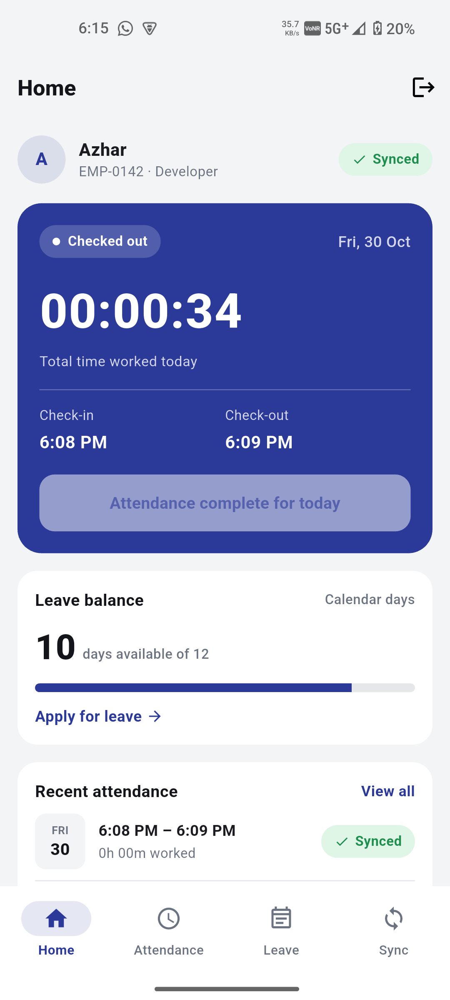
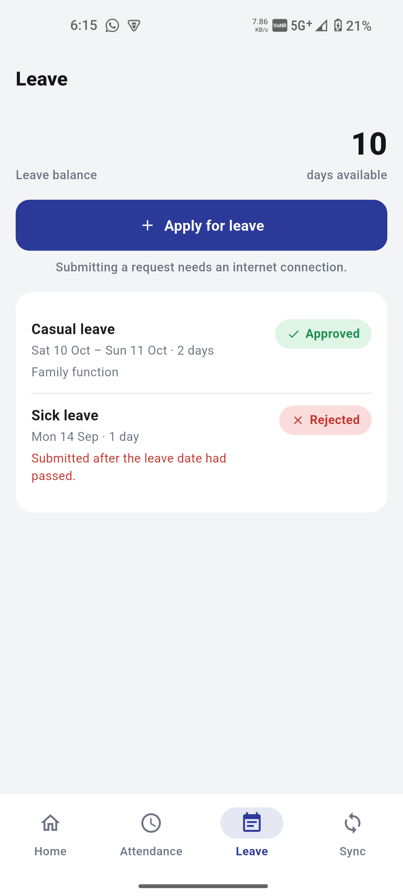
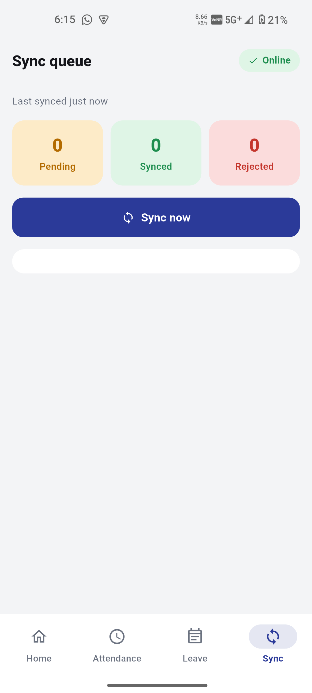

# REBS HRMS — Employee Workspace

A Flutter (Android) app that lets an employee **check in and out by location**,
see their **attendance history**, **apply for leave**, and keep working
**offline**. Check-ins made without a connection are saved on the phone and
synced to the server automatically when the connection comes back.

The app talks to a local **mock API server** (written in Dart) instead of a
real backend.

> **New here?** [SETUP.md](SETUP.md) has step-by-step instructions in plain
> language, including a troubleshooting section for every common error.

---

## Quick start

```bash
flutter pub get

# Terminal 1 — the mock server (leave it running)
dart run bin/mock_server.dart

# Terminal 2 — the app
flutter run                                                    # Android emulator
flutter run --dart-define=API_BASE_URL=http://localhost:8080   # real phone over USB
```

For a real phone over USB, also run this once the app is installed (and again
after replugging the cable or restarting `flutter run`):

```bash
adb reverse tcp:8080 tcp:8080
```

**Demo login:** Employee ID `EMP-0142`, password `welcome123`.

---

## Screenshots

| Home | Leave | Sync |
|:---:|:---:|:---:|
|  |  |  |

---

## Features

| Screen | What it does |
|---|---|
| **Login** | Employee ID and password. The session is saved, so you stay logged in after closing the app |
| **Home** | Employee header with a sync status chip. Today's card shows a **live timer** that counts up every second, check-in and check-out times, and the Check in / Check out button. Also shows leave balance and the last 5 days of attendance, including today |
| **Check in / out** | Radar view of you and the office, distance and GPS accuracy, an "outside the permitted area" warning, and Refresh location. Handles denied, permanently denied and GPS-off location permission |
| **Attendance** | Month-by-month history, each day marked Synced, Pending or Rejected (with the reason) |
| **Leave** | Balance and request history (Pending / Approved / Rejected with reason). **Apply for leave** offers Casual or Sick, start and end dates, and a reason, with live validation |
| **Sync** | Online/Offline chip, Pending / Synced / Rejected counts, a **Sync now** button, and every check-in/out attempt with its status. The tab badge shows the live pending count |

The data screens show a loading state, an error state ("Try again"), an empty
state, and an offline banner ("You're offline. Showing data saved at …").
On Home, pull to refresh reloads data while keeping it on screen.

### Offline sync

1. A check-in or check-out is **saved on the phone first**, before any network
   call, with a unique `eventId` and status *pending*. Closing the app or losing
   signal can't lose it.
2. Pending events sync **in the order they were made**, when the attempt is
   made online, when the connection returns, or when you tap **Sync now**.
3. Each event's `eventId` makes retries safe: sending the same event twice
   never creates a duplicate record.
   - **Same event already on the server** (`409` with the same `eventId`): marked *Synced*.
   - **Rejected by the server** (any other `409` or `422`): marked *Rejected*, with the server's reason.
   - **Timeout, `5xx` or connection error:** the app asks the server (`GET /attendance/events/:id`) whether the event arrived before retrying. If the server doesn't have it (`404`), it stays *pending*. If the server still can't be reached, syncing stops for now.
4. Home, Attendance, Sync and the badge **update by themselves** when an event
   is saved or synced, and when the connection drops or returns.

---

## Architecture

**MVVM with `flutter_bloc`.** Every feature uses a `Bloc` (not `Cubit`) with
explicit event classes.

```
View (Widget) → ViewModel (Bloc<Event, State>) → Repository → { Local (Hive), Remote (Dio) }
```

- **View**: widgets only. They read state with `BlocBuilder` and send events with `bloc.add(...)`.
- **ViewModel**: one sealed `State` (loading / loaded / error / …) and one sealed `Event` per feature.
- **Repository**: business rules, and the choice between local and remote data. Offline-first: it tries the API, saves the result locally, and falls back to the saved data if the API fails.
- **Data sources**: Hive boxes for local storage (employee, attendance, pending events, leave, metadata) and a Dio `ApiClient` for the network.

```
bin/mock_server.dart                 CLI entry for the mock API
lib/
  main.dart                          app + theme; shows Login or the tab bar
  bottom_nav_bar/nav_bar.dart        Home · Attendance · Leave · Sync tabs (+ live badge)
  mock_server/mock_api_server.dart   mock API (shelf)
  core/
    data/models/                     DTOs (employee, attendance record/event, leave)
    data/local/                      Hive store + one local data source per entity
    network/                         ApiClient (Dio), ApiConfig, ConnectivityService, LocationService
    theme/  widgets/  utils/  models/
  features/
    auth/        data/ + presentation/ (view, viewmodel)
    dashboard/   data/ + presentation/ (view, viewmodel, widgets)
    attendance/  data/attendance_repository.dart  ← saved-first event log, sync engine, history
                 presentation/ (check-in + history screens)
    leave/       data/ + presentation/ (leave list + apply screens)
    sync/        presentation/ (reads the same AttendanceRepository)
```

There's one shared `AttendanceRepository` for check-in, sync, history and the
dashboard, because "pending events" is a single idea, not something specific
to the Sync screen.

**Packages:** `flutter_bloc`, `equatable`, `dio`, `hive` / `hive_flutter`,
`connectivity_plus`, `geolocator`, `intl`, `uuid`. The mock server uses `shelf`
and `shelf_router`.

---

## Validation: phone vs. server

| Rule | On the phone | On the server |
|---|---|---|
| Must be within the office radius to check in/out | ✅ distance check, button disabled outside the radius | ❌ not checked by the mock server (see Limitations) |
| No check-out without a check-in | ✅ button only offered when checked in | ✅ `422 Cannot check out before checking in` |
| Only one check-in per day | ✅ | ✅ `409 Already checked in today` |
| No duplicate events on retry or double tap | ✅ repeated-tap guard | ✅ idempotent by `eventId` (`409` echoing the stored event) |
| Leave: end date not before start date | ✅ inline | ✅ `422` |
| Leave: reason at least 10 characters | ✅ live character count | ✅ `422` |
| Leave: days not more than the balance | ✅ | ✅ `422` |
| Leave: no overlap with pending/approved leave | ✅ checks saved requests | ✅ `422` |
| Leave needs a connection | ✅ Submit disabled offline | — |

The phone checks first so the user gets instant feedback. The server checks
again because it has the final say. When they disagree, the server's message
is shown.

---

## Mock API server

```bash
dart run bin/mock_server.dart [port] [--lat=<deg>] [--lng=<deg>] [--radius=<m>] [--data=<file>] [--fresh]
```

| Option | Default | Meaning |
|---|---|---|
| `port` | `8080` | Port to listen on |
| `--lat` / `--lng` | `10.05566` / `76.35416` | Office location (Kochi Campus, Technology Innovation Zone, Kalamassery) |
| `--radius` | `200` | Check-in radius in metres |
| `--data` | `mock_server_data.json` | File where check-ins and leave are saved, so they survive a restart |
| `--fresh` | — | Delete that file and start with the demo data |

### Endpoints

| Method | Path | Notes |
|---|---|---|
| POST | `/auth/login` | `{ employeeId, password }` → `{ token, employee }`, or `401` |
| GET | `/employee/me` | Profile and office location (lat / lng / radius) |
| GET | `/attendance?month=YYYY-MM` | Attendance records for a month |
| POST | `/attendance/events` | Check-in/out. Idempotent by `eventId` (replay returns `409` with the stored event). `422` for check-out before check-in, `409` for a second check-in |
| GET | `/attendance/events/:eventId` | One event's status (used to re-check after a timeout) |
| GET | `/leave` | Balance and request history |
| POST | `/leave/requests` | Validates reason length, date order, overlap and balance |
| POST | `/debug/scenario` | `{ "endpoint": "attendance" \| "leave", "mode": "..." }`: applies a scenario to every later call |
| POST | `/debug/reset` | Restores the demo data and clears scenarios |

### Simulating problems

Attendance-event and leave-request calls accept `?simulate=<mode>` (for one
call), or you can set a scenario with `/debug/scenario`:

| Mode | Effect |
|---|---|
| `success` | normal (default) |
| `slow` | about 4 s delay, then succeeds |
| `timeout` | about 20 s delay, longer than the app's 10 s timeout |
| `serverError` | `500` |
| `duplicate` | forces `409` (attendance only) |
| `validationError` | forces `422` (leave only) |

```powershell
Invoke-RestMethod -Method Post http://localhost:8080/debug/scenario -ContentType 'application/json' -Body '{"endpoint":"attendance","mode":"serverError"}'
```

---

## Assumptions

- One preconfigured employee (`EMP-0142`), one office location.
- One attendance session per day. No overnight shifts.
- Times use the **phone's local time zone**.
- Every calendar day counts as a leave day (weekends and holidays included).
- Syncing only happens while the app is open (in the foreground). Background sync while the app is closed is out of scope.
- The office location is set with the mock server's `--lat`, `--lng` and `--radius` options so reviewers can test from anywhere.

## Known limitations

- **The server doesn't re-check location.** The phone sends its latitude and longitude with every event, but the mock server doesn't compare them with the office. The check-in screen's note that "the server checks your location again" describes how a real backend should behave.
- **The login token isn't used.** It's saved on the phone but not sent with API calls, and the mock server doesn't require it.
- **Android only.** iOS location permission text (`NSLocationWhenInUseUsageDescription`) hasn't been added, so check-in won't work on iOS.
- **Rejected events can't be fixed in the app.** A rejected check-in or check-out stays rejected. Clearing the app's data is the only way to reset it.
- **Saved data isn't encrypted** (Hive boxes).
- **Layout has been checked on a phone only, not on a tablet.**

---

## Time spent

_TODO: fill in, e.g. a per-phase breakdown from DEVELOPMENT_PLAN.md._

## AI tools and references

- **Claude** (Anthropic) was used during development.
- **UI design** was inspired by reference designs found on **Pinterest**.
